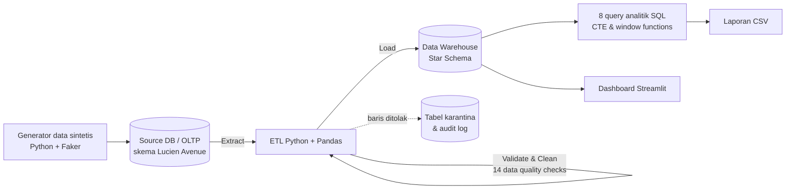
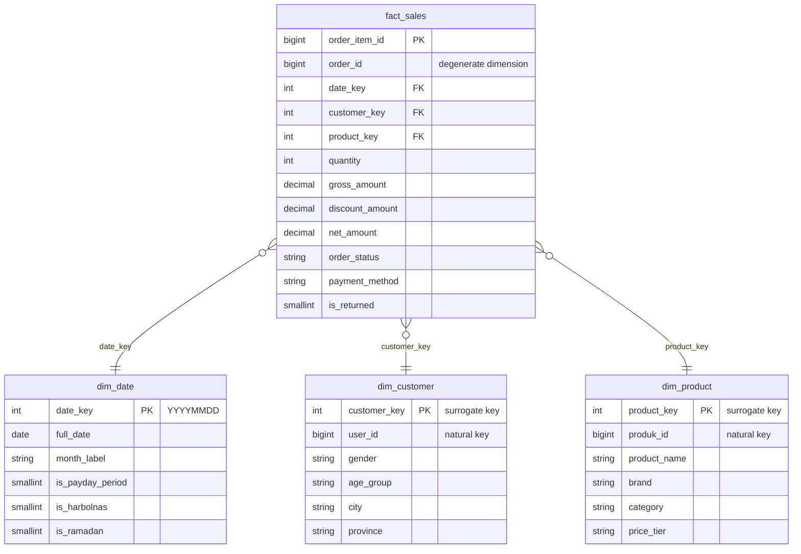

# 👟 Lucien Avenue — Sales Analytics Pipeline

End-to-end data pipeline untuk platform e-commerce sneakers **Lucien Avenue**: dari database transaksi (OLTP), melalui proses **ETL dengan validasi kualitas data**, ke **data warehouse berskema bintang (star schema)**, hingga **query analitik SQL** dan **dashboard interaktif**.

   

> **Latar belakang.** Lucien Avenue adalah aplikasi e-commerce yang saya kembangkan bersama tim (saya di bagian frontend, Vue.js) — [repo frontend](https://github.com/GITikhsan/LUCIEN-AVENUE-FRONTEND) · [repo backend](https://github.com/GITikhsan/LUCIEN-AVENUE-BACKEND). Proyek ini adalah lanjutan mandiri: membangun **lapisan analitik** di atas sistem transaksinya.
>
> **Catatan data.** Karena tidak ada data produksi, data transaksi **dibangkitkan secara sintetis** mengikuti skema database asli aplikasi (diambil dari migration Laravel), lengkap dengan pola musiman dan masalah kualitas data yang realistis.

<!-- Screenshot dashboard: simpan gambar di docs/dashboard.png, lalu hapus tanda komentar pada baris di bawah.

-->

---

## Arsitektur



## Star schema (grain: satu baris per item pesanan)



---

## Fitur utama

**1. Generator data realistis** (`src/generator/`) — ±36 ribu pesanan selama 2 tahun (2024–2025) dari 10 ribu pelanggan, dengan tren pertumbuhan, lonjakan Harbolnas (11.11 & 12.12), tanggal kembar, periode gajian, dan Ramadan. Pelanggan loyal dimodelkan dengan distribusi lognormal, dan preferensi pembayaran bergeser ke QRIS/e-wallet seiring waktu.

**2. ETL dengan validasi kualitas data** (`src/etl/`) — setiap masalah dicatat ke tabel `data_quality_log`, dan pelanggaran integritas (primary key duplikat, orphan foreign key) **menghentikan pipeline** sebelum data salah masuk ke warehouse. Hasil run default:

| Masalah yang ditemukan | Baris | Tindakan |
|---|---:|---|
| Format jenis kelamin tidak standar (`L`, `Laki-laki`, `P`, ...) | 3.095 | dipetakan ke Pria / Wanita / Tidak diketahui |
| Penulisan kota tidak standar (`Jogja`, `Jaksel`, `Kab. Sleman`, ...) | 1.859 | distandarkan via tabel alias kota |
| Email dengan spasi/huruf kapital | 328 | dinormalisasi |
| Pesanan ganda (double submit < 60 detik) | 146 | dihapus |
| `jumlah_total` ≠ `subtotal − discount` | 110 | nilai dihitung ulang dari item |
| Quantity item tidak valid (≤ 0) | 89 | dikarantina ke `quarantine_order_items` |
| Akun internal/testing (& 36 pesanannya) | 4 | dikecualikan dari warehouse |
| Tanggal lahir mustahil (tahun 1900 / masa depan) | 19 | dikosongkan |

**3. Data warehouse star schema** — dimensi tanggal lengkap dengan penanda kalender Indonesia (gajian, Harbolnas, Ramadan), surrogate key, dan indeks pada foreign key tabel fakta.

**4. Delapan query analitik SQL** (`sql/analytics/`):

| Query | Teknik SQL |
|---|---|
| Pendapatan bulanan + pertumbuhan MoM & YoY | CTE, `LAG()` |
| Top 3 produk per kategori | `ROW_NUMBER() OVER (PARTITION BY ...)` |
| Segmentasi pelanggan RFM | `NTILE()`, `CASE`, `CROSS JOIN` |
| Cohort retention bulanan | multi-CTE, self-referencing aggregation |
| Tren metode pembayaran | `SUM() OVER (PARTITION BY ...)` |
| Tingkat retur per kategori | agregasi bersyarat |
| Dampak momen belanja (Harbolnas, Ramadan, gajian) | `LEFT JOIN` ke dimensi tanggal, indeks relatif |
| Top 10 kota | subquery skalar untuk porsi kontribusi |

**5. Dashboard interaktif** (`dashboard/app.py`) — 4 tab (Penjualan, Produk, Pelanggan, Data Quality) dengan filter tahun, brand, kategori, dan provinsi.

**6. Kualitas kode** — 26 unit test (pytest), CI GitHub Actions, dan SQL yang portabel: diuji berjalan di **SQLite** maupun **MySQL/MariaDB**.

---

## Contoh insight (dari data sintetis)

- **Harbolnas sangat berdampak:** pendapatan harian saat 11.11 & 12.12 mencapai **3,6×** hari kerja biasa; Ramadan **1,5×**; periode gajian **1,28×**.
- **Pareto pelanggan:** segmen *Champions* (20,6% pelanggan) menyumbang **51% pendapatan**, sedangkan segmen *At Risk* masih memegang 19% pendapatan — kandidat utama kampanye retensi.
- **Kategori lari punya tingkat retur tertinggi (4,9% vs rata-rata 3,3%)**, dengan alasan dominan "ukuran tidak sesuai" → rekomendasi: panduan ukuran yang lebih jelas di halaman produk lari.
- **Pergeseran pembayaran:** pangsa QRIS naik dari 12,7% (2024) ke 18,7% (2025), sementara Virtual Account turun dari 32,4% ke 27,0%.
- **Hati-hati membaca YoY:** Maret 2025 tumbuh 50% YoY, tetapi April 2025 hanya 0,2%, karena Ramadan 2025 jatuh penuh di bulan Maret (2024 terbagi Maret–April). Pertumbuhan tahunan riil: **+21,5%**.

---

## Cara menjalankan

Membutuhkan Python 3.10+.

```bash
git clone https://github.com/Zaidanelha/lucien-avenue-analytics.git
cd lucien-avenue-analytics
python -m venv .venv
# Windows: .venv\Scripts\activate   |   macOS/Linux: source .venv/bin/activate
pip install -r requirements.txt

python run_pipeline.py all        # generate data -> ETL -> laporan (±1 menit)
streamlit run dashboard/app.py    # buka dashboard di browser
pytest -v                         # jalankan unit test
```

Langkah juga bisa dijalankan terpisah: `python run_pipeline.py generate | etl | report`.

**Memakai MySQL / MariaDB (mis. XAMPP):** buat database `lucien_source` dan `lucien_dw`, salin `.env.example` menjadi `.env`, lalu aktifkan baris `SOURCE_DB_URL` dan `WAREHOUSE_DB_URL`.

---

## Keputusan desain

- **Grain fakta = item pesanan**, bukan pesanan, agar analisis per produk/brand/kategori tidak memerlukan tabel terpisah. Diskon level pesanan **dialokasikan proporsional** ke tiap item.
- **Surrogate key** di dimensi memisahkan warehouse dari ID sistem sumber.
- **Minimisasi data pribadi:** nama, email, telepon, alamat lengkap, dan password **tidak** dimuat ke warehouse; analisis cukup memakai atribut agregat (kota, kelompok usia, gender).
- **SQL portabel:** perhitungan selisih waktu memakai kolom `day_number`/`month_number` di `dim_date`, bukan fungsi tanggal yang berbeda-beda antar-database. Nama kolom yang merupakan reserved word di MySQL (mis. `YEAR_MONTH`) dihindari.
- **Karantina, bukan hapus diam-diam:** baris yang ditolak disimpan beserta `run_id` sehingga bisa ditelusuri.
- **Full refresh** dipilih karena volume data masih kecil dan membuat pipeline idempoten (hasil sama setiap dijalankan ulang).

**Lesson learned:** versi awal deteksi duplikat memakai kombinasi `produk_id + quantity` sebagai sidik jari keranjang, dan meloloskan 2 duplikat karena kolom quantity-nya ikut rusak. Masalah ini terdeteksi lewat pemeriksaan lain ("pesanan tanpa pembayaran"), lalu sidik jari diubah menjadi `produk_id` saja; kasus tersebut kini dijadikan unit test.

## Pengembangan selanjutnya

Incremental load berbasis *watermark* (`updated_at`), orkestrasi terjadwal (Apache Airflow), transformasi dengan dbt, containerisasi (Docker), dan uji skala menggunakan mesin kolumnar (DuckDB/ClickHouse) atau Spark untuk volume data yang lebih besar.

## Struktur proyek

```
lucien-avenue-analytics/
├── run_pipeline.py          # entry point CLI
├── config.py                # konfigurasi (bisa di-override via .env)
├── sql/
│   ├── source_schema.sql    # skema OLTP (meniru migration Laravel Lucien Avenue)
│   ├── warehouse_schema.sql # star schema
│   ├── warehouse_audit.sql  # etl_run_log, data_quality_log, quarantine
│   └── analytics/           # 8 query analitik
├── src/
│   ├── generator/           # pembangkit data sintetis
│   ├── etl/                 # extract, transform, quality, load, pipeline
│   └── analytics/           # runner laporan
├── dashboard/app.py         # dashboard Streamlit
├── tests/                   # unit test
└── .github/workflows/ci.yml # CI: test + pipeline end-to-end
```

---

Dibuat oleh **Muhammad Zaidan Elha Rasyad** · Informatika, Universitas Amikom Yogyakarta · [GitHub](https://github.com/Zaidanelha)
